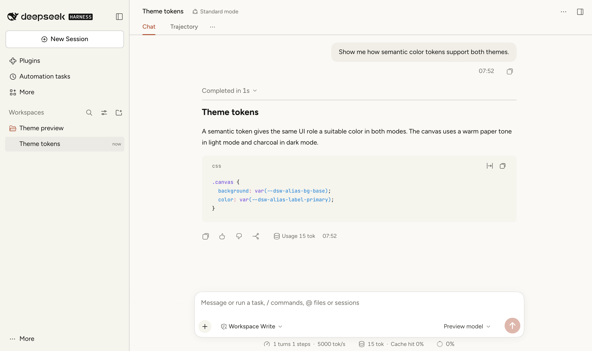
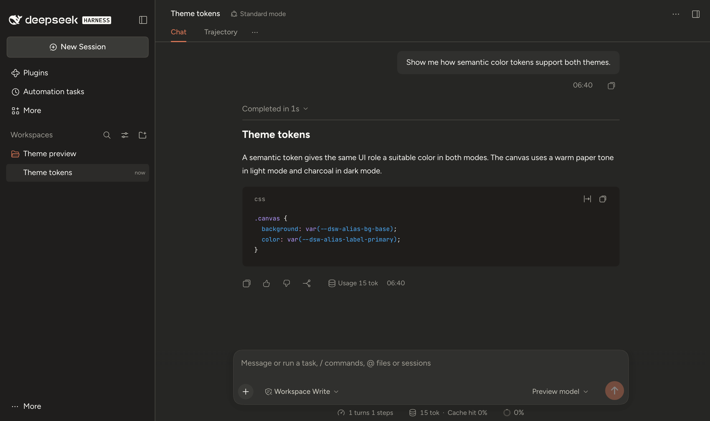

# dsh-claudelike-ui

[简体中文](README.zh.md)

A non-destructive claude.ai-inspired visual skin for DeepSeek Harness.
It pairs warm parchment light surfaces and charcoal dark surfaces with clay accents,
Figtree / Source Serif 4 / JetBrains Mono typography, and softened radii without changing layout,
shortcuts, or focus behavior.
Toggle **Claude-like UI** in **Settings → General** at any time without disabling the bundle.

## Screenshots

| Light | Dark |
| --- | --- |
|  |  |

## Install

Requires DeepSeek Harness `0.2.2-rc.5` or newer on Desktop or Web.
Enable **Claude-like UI skin** in **Visual Modular Improvement Plan**, or install standalone:

- From GitHub: `dsh plugin --profile desktop add github:miorin-chan/dsh-claudelike-ui`
- From source: run `pnpm install --frozen-lockfile` in a checkout, select the directory in **Plugins → Add plugin**,
  and enable **Claude-like UI skin**.

[Project documentation](docs/README.md) · [Design](docs/DESIGN.md) · [MIT License](LICENSE)
