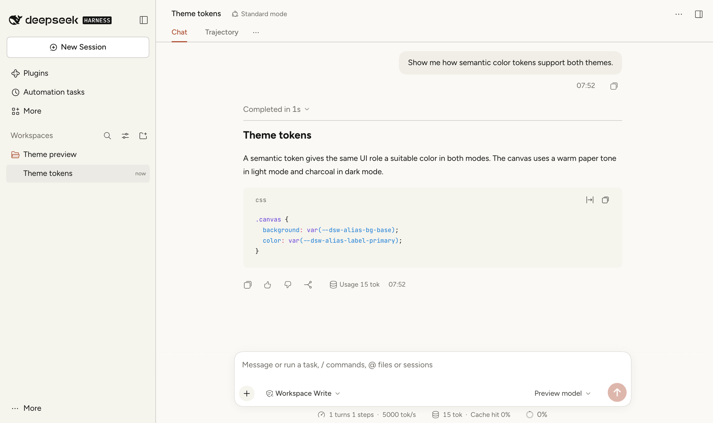
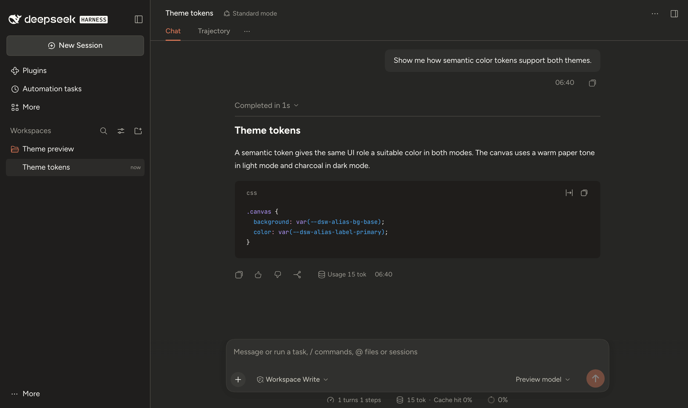

# dsh-claudelike-ui

[English](README.md)

为 DeepSeek Harness 提供的非破坏性 claude.ai 风格视觉皮肤。
以暖米白浅色纸面、深炭黑深色背景、陶土橙强调色、Figtree / Source Serif 4 / JetBrains Mono 字体与柔和圆角替换视觉层，
不改动原有布局、快捷键或焦点行为。
可随时在 **设置 → 通用** 开关 **Claude 风格**，无需停用插件。

## 界面截图

| 浅色 | 深色 |
| --- | --- |
|  |  |

## 安装

需要 DeepSeek Harness `0.2.2-rc.5` 或更新版本（Desktop 与 Web 均适用）。
可在 **外观模块化改良计划** 中直接开启 **Claude 风格 UI 皮肤**，或单独安装：

- 从 GitHub 安装：`dsh plugin --profile desktop add github:miorin-chan/dsh-claudelike-ui`
- 从本地源码安装：在仓库目录运行 `pnpm install --frozen-lockfile`，
  再从 **插件 → 添加插件** 选择该目录并启用 **Claude 风格 UI 皮肤**。

[项目文档](docs/README.md) · [设计笔记](docs/DESIGN.md) · [MIT 许可证](LICENSE)
